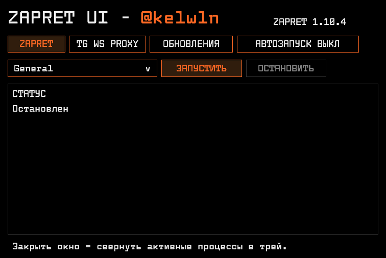
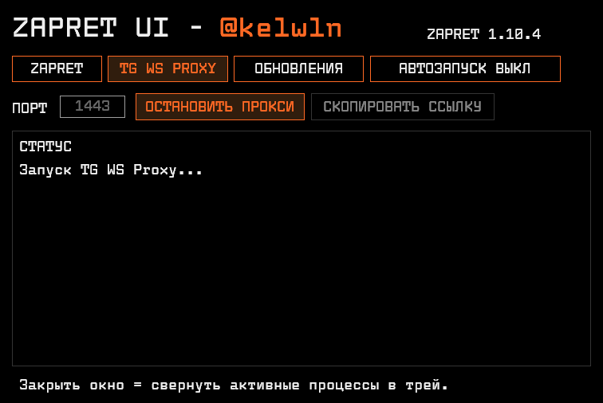
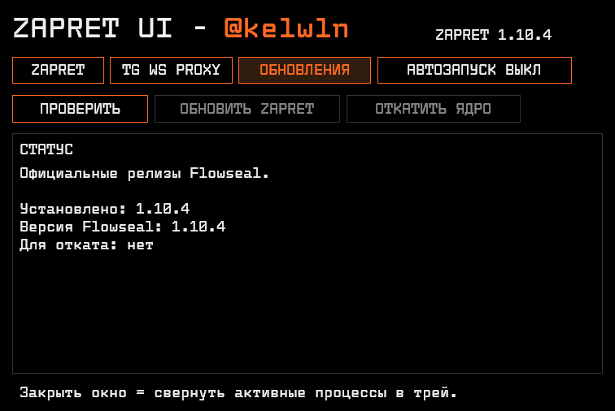

<p align="center">
  
</p>

<p align="center">
  <a href="https://github.com/Kelw1n/zapret-ui/releases/latest"></a>
  <a href="https://github.com/Kelw1n/zapret-ui/releases"></a>
</p>

# Zapret UI

Нативное приложение на Rust для управления **Flowseal Zapret** и локальным **TG WS Proxy**. Кнопки запуска, выбор стратегии, обновление ядра и откат доступны из одного окна. Интерфейс оформлен в стиле TweakGRID со шрифтом LLG Relicus.

## Скриншоты

<p align="center"></p>

| TG WS Proxy | Обновления Zapret |
| --- | --- |
|  |  |

## Возможности

| Раздел | Что можно сделать |
| --- | --- |
| **Zapret** | Выбрать стратегию Flowseal и запустить или остановить её в фоне. |
| **SoundCloud** | Стратегии Flowseal автоматически подключают отдельные списки доменов SoundCloud и четыре точечных IP-адреса. Они подхватываются при каждом запуске стратегии, включая запуск после обновления ядра. |
| **TG WS Proxy** | Запустить локальный MTProto-прокси на `127.0.0.1`, выбрать порт и скопировать ссылку для Telegram Desktop. Порт по умолчанию `1443`. |
| **Обновления** | Проверить стабильный релиз в официальном репозитории Flowseal, обновить ядро или вернуться к предыдущей установленной версии. Перед установкой архив сверяется по размеру и SHA‑256. Пользовательские списки и Game Filter сохраняются. |
| **Автозапуск и трей** | Открывать интерфейс в трее при входе в Windows и восстанавливать включённые компоненты. Активные процессы продолжают работать при закрытии окна. Остановить их можно кнопками в окне или через меню трея. |

## Потребление ресурсов

На снимке Диспетчера задач процесс `ZapretUI.exe` в простое занимал **2,7 МБ памяти**, а загрузка ЦП составляла **0%**. Замер относится к интерфейсу. При запуске Zapret и TG WS Proxy их процессы учитываются отдельно.

## Быстрый запуск

1. Скачай `ZapretUI.exe` из последнего релиза, запусти его и подтверди запрос администратора для WinDivert. [Скачать из Releases](https://github.com/Kelw1n/zapret-ui/releases/latest)
2. Выбери стратегию на вкладке **ZAPRET** и нажми **ЗАПУСТИТЬ**.
3. Для Telegram открой вкладку **TG WS PROXY**, запусти прокси и скопируй ссылку. Открой её на том же ПК, например через **Win+R**.
4. Чтобы открывать приложение при входе в Windows, нажми **АВТОЗАПУСК ВЫКЛ**. Повторное нажатие отключает автозапуск.

Поддерживаются Windows 10 и Windows 11 x64. Ядро, прокси и его Python уже встроены в один `.exe`. Исполняемые файлы компонентов распаковываются в защищённый каталог `%ProgramFiles%\ZapretUI-Autostart`. Настройки запуска хранятся в `%LOCALAPPDATA%\ZapretUI`.

Автозапуск включается только по кнопке и открывает сам интерфейс в трее. Для него приложение регистрирует задачу Планировщика Windows для текущего пользователя и использует защищённую копию из `%ProgramFiles%\ZapretUI-Autostart`. Приложение запоминает включённые компоненты, последнюю запущенную стратегию Zapret и порт прокси. Кнопки остановки сбрасывают сохранённое состояние соответствующего компонента. После обновления нажми **ОБНОВИТЬ АВТОЗАПУСК**, если кнопка показывает это действие.

## Сборка из исходников

На Windows установи Rust с MSVC toolchain и Visual Studio Build Tools с компонентом «Разработка классических приложений на C++». В каталоге проекта выполни:

```powershell
cargo build --release --locked
```

Готовый файл появится в `target\release\zapret-ui.exe`.

## Компоненты

- [Flowseal Zapret](https://github.com/Flowseal/zapret-discord-youtube)
- [Flowseal TG WS Proxy](https://github.com/Flowseal/tg-ws-proxy)
- [WinDivert 2.2.2 и исходный код](https://github.com/basil00/WinDivert/tree/v2.2.2)
- [Встроенный Python 3.13.12](https://www.python.org/downloads/release/python-31312/)

Лицензии компонентов доступны в архиве релиза с исходниками либо в рабочем каталоге после распаковки соответствующего компонента.
